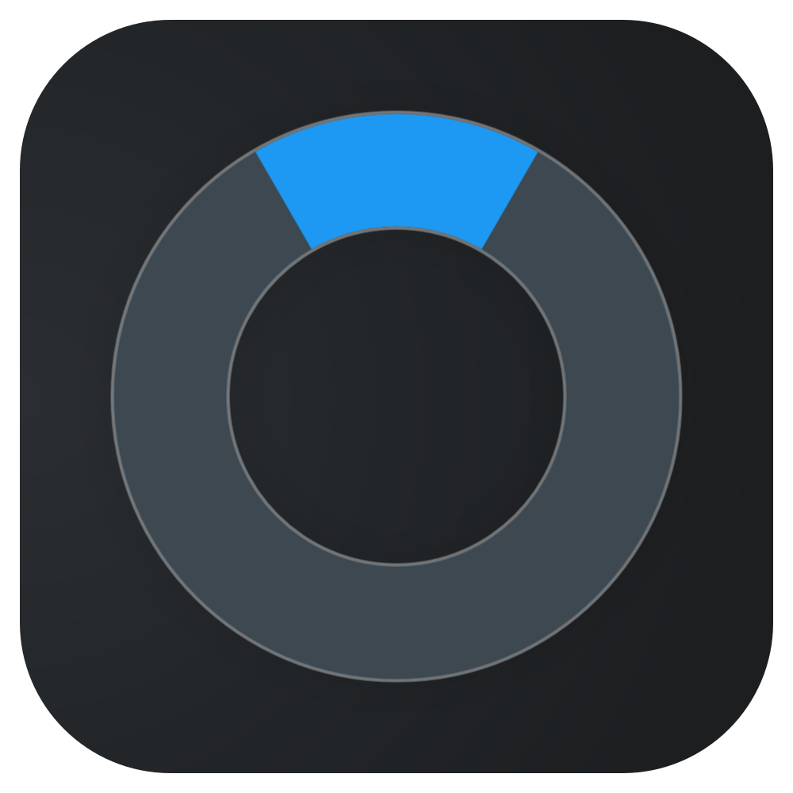

<div align="center">
    
    <h1><b>Sirkel</b></h1>
</div>

Window snapping for KDE Plasma 6.7+ on Wayland, inspired by [Loop](https://github.com/MrKai77/Loop) on macOS.

Hold a shortcut of your choice (or Caps Lock), move the mouse toward where you want the window, and let go. It snaps to that half or quarter of the screen, or fills the screen if you leave the mouse in the middle. A small ring follows your direction and an outline shows where the window will end up, so you know what you'll get before you let go.

This is version 0.5.3. It's early and I've only tested it on my own machine, so settings may still change.

> [!WARNING]
> You have to rebuild Sirkel after every Plasma update, even small ones like 6.8.0 to 6.8.1. KWin refuses to load effects that were built for a different version. See [Installation](#installation).

## Demo
[demo-video.webm](https://github.com/user-attachments/assets/7f5a1d62-6c34-4b2f-83e8-b8504662fea3)


## Features

- Snap to the left, right, top or bottom half, any of the four quarters, or full screen.
- Pick a direction with the mouse or the keyboard (arrow keys, WASD or HJKL). Press two keys together, like Up and Left, for a corner.
- Start it with any key combination you like, such as Meta+Z. If you want a dedicated key, you can turn Caps Lock into one with keyd.
- Set your own shortcuts that snap straight away, without the ring. None are set out of the box.
- Scroll while holding the trigger to change the size: 1/4, 1/3, 1/2 or 2/3 of the screen. Full screen goes 1/3, 1/2, full width. This is off by default.
- Snap the active window or the one under the mouse, on its own monitor or the one the mouse is on.
- Add gaps around windows. Two windows next to each other get the same gap between them as against the screen edge.
- Drag a snapped window away and it gets its old size back, like Plasma's own tiling.
- Windows that can't be resized, or can't get as small or as big as the spot you picked, are centered on it and kept on screen. Fullscreen games and videos are left alone, and you can exclude apps.
- Colors follow your Plasma accent color, or pick your own. The ring uses a darker, softer version of the accent so the pointer stands out.
- Optional blur behind the preview, with adjustable animation speed and style.
- A settings window with a live preview, so you can see changes as you make them.

## Requirements

- KDE Plasma 6.7 or newer, on Wayland
- Optional: [keyd](https://github.com/rvaiya/keyd), if you want to use Caps Lock as the trigger
- To build it: CMake, Extra CMake Modules, Qt 6 (Core, Gui, Qml, Quick, DBus, Test, Widgets), KDE Frameworks 6 (Config, ColorScheme, CoreAddons, GlobalAccel, I18n, KCMUtils, WindowSystem) and the KWin development headers

[Geometry Change](https://github.com/peterfajdiga/kwin4_effect_geometry_change) works well alongside Sirkel if you want the window itself to animate into place.

## Installation

### 1. Build and install

```sh
cmake -B build
cmake --build build
sudo cmake --install build
```

On Arch and Arch-based systems you can build a package instead. For the latest release, run this in `packaging/sirkel`:

```sh
makepkg -si
```

Running it in `packaging/sirkel-git` instead builds the latest development version from GitHub (`sirkel-git`), not the copy on your disk. Both packages run the tests while building, and come with a pacman hook that reminds you to rebuild Sirkel whenever KWin is upgraded.

**After every Plasma update**, rebuild and reinstall, then log out and back in:

```sh
cmake --build build
sudo cmake --install build
```

If you installed with the PKGBUILD, just run `makepkg -si` again. The About page in Sirkel's settings tells you when a rebuild is needed.

### 2. Turn it on

Go to **System Settings → Desktop Effects** and enable **Sirkel**.

### 3. Set a trigger

Sirkel doesn't come with a key combination set. Out of the box its trigger is F24, which only Caps Lock sends once keyd is set up (below), so **without keyd, nothing starts Sirkel until you set a trigger yourself**. The General page in Sirkel's settings shows in orange when no working trigger is set.

Open Sirkel's settings, go to **Shortcuts** and record the key combination you want to hold, for example Meta+Z. That's all you need to start using it.

### Optional: use Caps Lock instead

Most people never use Caps Lock, which makes it a great trigger: one key, right under your finger, with nothing else on it. Sirkel listens for the F24 key, and [keyd](https://github.com/rvaiya/keyd) can turn Caps Lock into F24. Add this to `/etc/keyd/default.conf` (Sirkel never touches that file itself):

```ini
[ids]
*

[main]
capslock = f24
```

Then start keyd:

```sh
sudo systemctl enable --now keyd
```

Finally, in Sirkel's settings under **Shortcuts**, set **Start Sirkel with** to **Caps Lock (via keyd)**. Caps Lock won't work as Caps Lock anymore after this. The About page shows whether keyd is set up correctly.

## Usage

1. Hold the trigger.
2. Move the mouse toward an edge or corner, or press a direction key. Keep the mouse near the middle of the ring to fill the screen.
3. Let go to snap.

While you hold the trigger, you can also press:

| Key | What it does |
|---|---|
| Enter | Fill the screen |
| Backspace | Minimize |
| Esc | Cancel |
| The same direction key again | Change the size: 1/2, 1/3, 1/4, 2/3 and round again (left, right, top and bottom) |
| Scroll wheel | Change the size (if turned on) |

Enter and Backspace can be changed to other keys, either on Sirkel's Shortcuts page or under Sirkel in **System Settings → Shortcuts**. They only do something while you hold the trigger.

## Settings

You'll find them under **System Settings → Desktop Effects → Sirkel**, or by searching for **Sirkel** in the app launcher. Changes apply right away.

- **General:** how you pick a direction, which keys to use, scrolling to resize, which window and monitor to snap, gaps, auto-cancel and excluded apps
- **Appearance:** size, shape and look of the ring and the outline, plus animation speed and style
- **Colors:** colors for the outline, the pointer and the ring
- **Shortcuts:** the trigger and your own snap shortcuts

The Appearance and Colors pages have a preview on the right. Drag the window edge to make it bigger, or hide it with the button at the top.

Every shortcut also shows up under Sirkel in **System Settings → Shortcuts**.

## Troubleshooting

**Sirkel stopped working after a Plasma update.** KWin only loads effects built for its exact version. Rebuild and reinstall (see [Installation](#installation)), then log out and back in. The About page in Sirkel's settings tells you whether this is the problem.

**Nothing happens when I hold the trigger.** The General page in Sirkel's settings says which trigger is set and whether it works. If you use Caps Lock, check that keyd is running (`systemctl status keyd`) and that Caps Lock sends F24: `sudo keyd monitor` shows the key while you press it.

**I want to see what Sirkel is doing.** Turn on its debug output in `kdebugsettings` (search for "sirkel"), log out and back in, then read KWin's log:

```sh
journalctl --user -b | grep -i sirkel
```

**KWin crashed.** Sirkel runs inside KWin, so a crash in Sirkel takes KWin down with it. Get the details with:

```sh
coredumpctl list kwin_wayland
coredumpctl info
```

and add the output to a [bug report](https://github.com/strandzen/Sirkel/issues).

**For developers:** `scripts/stress/stress-test.sh` runs Sirkel in a separate, headless KWin with simulated input and checks where windows end up, without touching your session.

## Uninstall

In the source folder, run:

```sh
sudo xargs rm < build/install_manifest.txt
```

If you used the package, run `sudo pacman -R sirkel-git` instead. To get Caps Lock back, remove the `capslock = f24` line from the keyd config and run `sudo systemctl restart keyd`.

## Compared to Loop

| Feature | Loop | Sirkel |
|---|---|---|
| Radial menu with live preview | ✅ | ✅ |
| Pick with mouse or arrow keys | ✅ | ✅ |
| Halves, quarters, thirds and size cycling | ✅ | ✅ |
| Gaps, themes and separate colors | ✅ | ✅ |
| Custom shortcuts per action | ✅ | ✅ |
| Move a window to another monitor | ✅ | ❌ |
| Undo / restore the original size | ✅ | ❌ |
| Stash, nudge, grow or shrink one edge | ✅ | ❌ |
| Snap by dragging to a screen edge | ✅ | ❌ |

## Planned

- Animate the window move in Sirkel itself, and a live mode where the window moves as you pick
- Fill the gap: hold a key while picking to fill an empty space between your windows

## Translations

Sirkel is available in English and Norwegian (Bokmål). See [po/README.md](po/README.md) for how to add a language.

## License

GPL-2.0-or-later. See [LICENSE](LICENSE).
