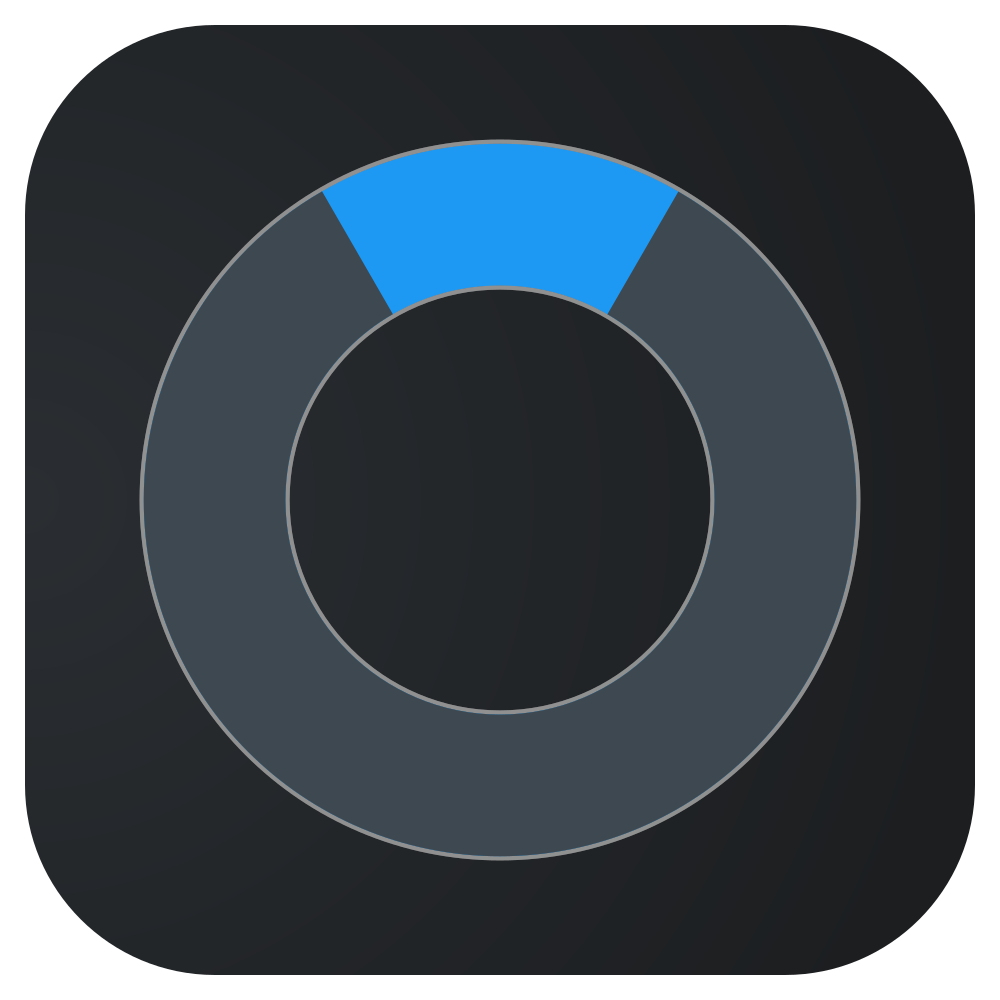

<div align="center">
    
    <h1><b>Sirkel</b></h1>
</div>

Window tiling for KDE Plasma 6.7+ on Wayland, inspired by [Loop](https://github.com/MrKai77/Loop) for macOS.

Hold Caps Lock (via keyd) or your own key combination, move the mouse toward where you want the window, and let go. The window tiles to that half or quarter of the screen, or fills it if you stay near the middle of the ring. A small ring follows your direction and an outline shows where the window will go.

This is version 0.6.0. It's early and I've only tested it on my own machine and in a VM, so settings may still change.

> [!WARNING]
> You have to rebuild Sirkel after every Plasma update, even small ones like 6.8.0 to 6.8.1. KWin refuses to load effects that were built for a different version. Sirkel tells you when, and can do it for you. See [Installation](#installation).

## Demo
[demo-video.webm](https://github.com/user-attachments/assets/7f5a1d62-6c34-4b2f-83e8-b8504662fea3)

## Features

- Tile to the left, right, top or bottom half, any of the four quarters, or full screen.
- Fill the gap: hold Shift too and point toward empty space, and the window fills the free space there.
- Pick a direction with the mouse or the keyboard (arrow keys, WASD or HJKL).
- Change the size with the same key again, or with the scroll wheel: 1/2, 1/3, 1/4 or 2/3 of the screen.
- Snap the active window or the one under the mouse, on its own monitor or the one the mouse is on.
- Gaps around windows, the same between two windows as against the screen edge.
- Drag a snapped window away and it gets its old size back, or press R to put it back where it was.
- Windows that can't take the size you picked are centered in the outline. Fullscreen windows are left alone, and you can exclude apps.
- Colors follow your Plasma accent color, or pick your own. Optional blur, animation speed and easing.
- A settings window with a live preview.

## Requirements

- KDE Plasma 6.7 or newer, Wayland only.
- Optional: [keyd](https://github.com/rvaiya/keyd), to use Caps Lock as the trigger.
- To build: `cmake extra-cmake-modules qt6-base qt6-declarative kconfig kcolorscheme kcoreaddons kglobalaccel ki18n kcmutils kwindowsystem knotifications kio kservice kwin`

[Geometry Change](https://github.com/peterfajdiga/kwin4_effect_geometry_change) is not required, but adds a nice animation when windows move.

## Installation

### 1. Build and install

On Arch and Arch-based systems, build the package. For the latest release, run this in `packaging/sirkel`:

```sh
makepkg -si
```

Run it in `packaging/sirkel-git` instead for the latest development version from GitHub.

On other systems:

```sh
cmake -B build
cmake --build build
sudo cmake --install build
```

### 2. Turn it on

Go to **System Settings → Desktop Effects**, enable **Sirkel**, then log out and back in.

### 3. Pick a trigger

The trigger is Caps Lock out of the box, which needs keyd (see below). Without keyd, open Sirkel's settings, go to **Shortcuts**, choose **A key combination** and record one, for example Meta+Z.

The General page in Sirkel's settings shows whether your trigger works.

### Caps Lock with keyd (recommended)

Most people never use Caps Lock, which makes it a great trigger: one key, right under your finger. Sirkel listens for the F24 key, and [keyd](https://github.com/rvaiya/keyd) can turn Caps Lock into F24. Add this to `/etc/keyd/default.conf` (Sirkel never touches that file itself):

```ini
[ids]
*

[main]
capslock = f24
```

Then start keyd:

```sh
sudo systemctl enable --now keyd
```

Caps Lock won't work as Caps Lock anymore after this. The About page shows whether keyd is set up.

### After every Plasma update

Sirkel needs a rebuild. When it does, a notification tells you, both at login and right after the update. Click it to open the About page, or click **Rebuild now** to start straight away: a terminal opens, builds and installs Sirkel (you need `base-devel`, and you'll be asked for your password). Then log out and back in.

Sirkel keeps working until you log out, so rebuilding right after the update means it never stops working.

If you built with CMake, run `cmake --build build` and `sudo cmake --install build` again instead.

## Usage

1. Hold the trigger.
2. Move the mouse toward an edge or corner, or press a direction key. Stay near the middle of the ring to fill the screen.
3. Let go of the trigger, or left-click, to tile.

While you hold the trigger, you can also press:

| Key | What it does |
|---|---|
| The same direction key again | Change the size: 1/2, 1/3, 1/4, 2/3 and round again. For a corner, keep one key held and tap the other |
| Scroll wheel | Change the size (turn it on in the settings) |
| Shift (held) | Fill the gap (see below) |
| Enter | Fill the screen |
| Backspace | Minimize |
| R | Put the window back where it was |
| Esc or right-click | Cancel |

Shift, Enter, Backspace and R can be changed on Sirkel's Shortcuts page.

### Fill the gap

Hold the trigger, then Shift, and point toward empty space. The outline shows the window filling the largest free space on that side, between your other windows. Let go of the trigger to put it there. Without a direction, it fills the largest free space anywhere.

- If there's no free space on that side, there's no outline and the ring dims.
- Press the trigger first, then Shift.

## Settings

Find them under **System Settings → Desktop Effects → Sirkel**, or search for **Sirkel** in the app launcher. The preview shows your changes right away; press **Apply** to use them.

- **General:** picking, keys, scrolling, which window and monitor, gaps, auto-cancel and excluded apps
- **Appearance:** the ring and the outline, animation speed and style
- **Colors:** colors for the outline, the pointer and the ring
- **Shortcuts:** the trigger and the keys you can use while holding it

Shortcuts that snap straight to a half or quarter, without the ring, are set under Sirkel in **System Settings → Shortcuts**.

## Troubleshooting

**Sirkel stopped working after a Plasma update.** Rebuild it (see [After every Plasma update](#after-every-plasma-update)). If a rebuild fails, its output is in `~/.cache/sirkel/rebuild.log`: please attach it to a [bug report](https://github.com/strandzen/Sirkel/issues).

**Nothing happens when I hold the trigger.** The General page in Sirkel's settings says whether your trigger works. With Caps Lock, check that keyd is running (`systemctl status keyd`) and that Caps Lock sends F24 (`sudo keyd monitor`).

**I want to see what Sirkel is doing.** Turn on its debug output in `kdebugsettings` (search for "sirkel"), log out and back in, then run:

```sh
journalctl --user -b | grep -i sirkel
```

**KWin crashed.** Sirkel runs inside KWin, so a crash in Sirkel takes KWin down too. Get the details with `coredumpctl info kwin_wayland` and add them to a [bug report](https://github.com/strandzen/Sirkel/issues).

## Uninstall

With the package: `sudo pacman -R sirkel` (or `sirkel-git`). With CMake, in the source folder:

```sh
sudo xargs rm < build/install_manifest.txt
```

To get Caps Lock back, remove the `capslock = f24` line from the keyd config and run `sudo systemctl restart keyd`.

## Compared to Loop

| Feature | Loop | Sirkel |
|---|---|---|
| Radial menu with live preview | ✅ | ✅ |
| Pick with mouse or arrow keys | ✅ | ✅ |
| Halves, quarters, thirds and size cycling | ✅ | ✅ |
| Fill the available space | ✅ | ✅ |
| Undo / restore the original size | ✅ | ✅ |
| Gaps, themes and separate colors | ✅ | ✅ |
| Custom shortcuts per action | ✅ | ✅ |
| Move a window to another monitor | ✅ | ❌ |
| Stash, nudge, grow or shrink one edge | ✅ | ❌ |
| Snap by dragging to a screen edge | ✅ | ❌ |

## Translations

Sirkel is available in English and Norwegian (Bokmål). See [po/README.md](po/README.md) for how to add a language.

## License

GPL-2.0-or-later. See [LICENSE](LICENSE).
